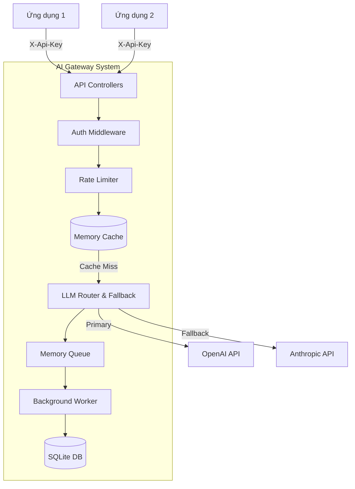
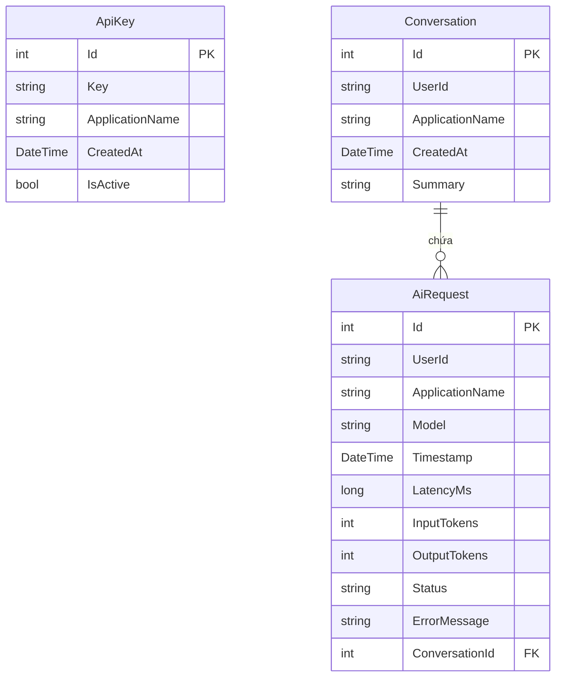

# AI Gateway API

Đây là dự án AI Gateway API đóng vai trò là một lớp trung gian (central layer) giữa các ứng dụng và các nhà cung cấp AI (LLM Providers).

## 1. Architecture Diagram

## 2. Database Schema

## 3. Các Tính Năng Nổi Bật (Features & Bonus)
- **Authentication**: Xác thực bằng `X-Api-Key`.
- **Resilience & Fallback**: Nếu OpenAI sập, hệ thống tự động nhảy sang Claude (Anthropic).
- **Queue-based Processing**: Request chat được phản hồi ngay lập tức, việc lưu log vào Database được tống vào Queue và xử lý ngầm.
- **Caching**: Các câu hỏi trùng lặp trong 5 phút sẽ được lấy từ Cache thay vì gọi AI (tiết kiệm chi phí).
- **Cost Estimation**: Hệ thống tự động tính toán số tiền (Cost) cho mỗi request dựa trên số lượng Token (input/output) tiêu thụ, lưu vào DB và trả về cho người dùng.
- **Rate Limiting**: Chống spam 100 requests/phút.

## 4. Hướng dẫn chạy & Demo
### Cách 1: Chạy bằng .NET CLI (Local)
1. Cấu hình file `appsettings.json`: Điền API key của OpenAI và Anthropic.
2. Mở Terminal gõ: `dotnet run` (Hệ thống sẽ chạy ở port mặc định: `http://localhost:5000`)
3. Import file `GatewayAI.postman_collection.json` vào Postman để test API. Code đã tạo sẵn key mặc định là `gateway-test-key-123` trong database để test luôn.

### Cách 2: Deploy bằng Docker (Production)
Dự án đã có sẵn file `Dockerfile`. Để deploy lên môi trường Cloud (ví dụ: Render, Railway, AWS ECS):
1. Build image: `docker build -t gatewayai .`
2. Chạy container ở port 8080: `docker run -p 8080:8080 gatewayai`
